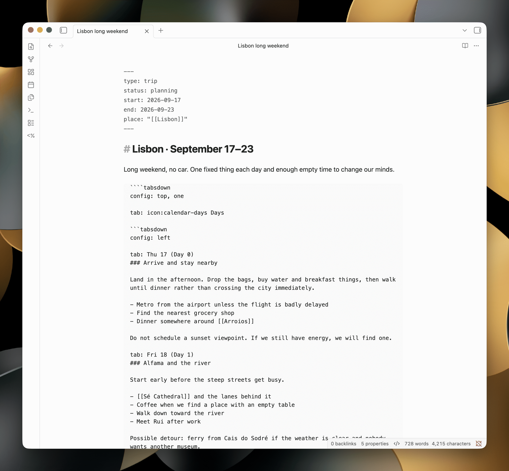

<picture>
  <source media="(prefers-color-scheme: dark)" srcset="https://raw.githubusercontent.com/grafanaKibana/obsidian-tabsdown/HEAD/docs/assets/product-captures/hero-dark.png">
  <source media="(prefers-color-scheme: light)" srcset="https://raw.githubusercontent.com/grafanaKibana/obsidian-tabsdown/HEAD/docs/assets/product-captures/hero.png">
  
</picture>

<p align="center">
Theme-native Markdown tabs for Obsidian. Works in Reading View and Live Preview on desktop and mobile.
</p>

<p align="center">
<a href="https://obsidian.md/plugins?id=tabsdown"><picture><source media="(prefers-color-scheme: dark)" srcset="https://shieldcn.dev/badge/Install_in_Obsidian.svg?variant=default&amp;size=sm&amp;font=geist&amp;mode=dark&amp;logo=obsidian&amp;color=a079ff&amp;logoColor=18181b&amp;valueColor=18181b&amp;labelTextColor=18181b&amp;gradient=a079ff%2Cac8aff%2C110"></picture></a>
<a href="https://github.com/grafanaKibana/obsidian-tabsdown/releases/latest"><picture><source media="(prefers-color-scheme: dark)" srcset="https://shieldcn.dev/github/release/grafanaKibana/obsidian-tabsdown/stable.svg?variant=outline&amp;size=sm&amp;font=geist&amp;mode=dark&amp;label=Version&amp;gradient=18181b%2C18181b%2C90&amp;labelTextColor=fafafa"></picture></a>
<a href="https://github.com/grafanaKibana/obsidian-tabsdown/actions/workflows/ci.yml"><picture><source media="(prefers-color-scheme: dark)" srcset="https://shieldcn.dev/github/ci/grafanaKibana/obsidian-tabsdown.svg?variant=outline&amp;size=sm&amp;font=geist&amp;mode=dark&amp;label=CI&amp;workflow=ci.yml&amp;branch=main&amp;statusDot=true&amp;gradient=18181b%2C18181b%2C90&amp;labelTextColor=fafafa"></picture></a>
</p>

- **Write in place:** edit the active tab’s Markdown in Live Preview, with the note’s Undo/Redo and keyboard navigation.
- **Choose your syntax:** comment markers or fenced code blocks, with the same features.
- **Shape your tabs:** nest layouts, format labels, add Lucide icons, and place the tab list on any side.
- **Edit your layout:** add, rename, or delete tabs and change block settings from context menus.

<details>
<summary>Watch Tabsdown in Obsidian</summary>



</details>

## Get started

Paste this into a note, keeping each marker on its own line:

```markdown
%% tabs %%
%% tab: Overview %%
Ordinary **Markdown**, links, and lists.

%% tab: Details %%
More content.
%% endtabs %%
```

Use at least two unique, non-empty labels. Tab bodies can contain ordinary Markdown, embeds, queries, callouts, math, Mermaid diagrams, and nested layouts. Compatible plugin blocks use Obsidian’s Markdown renderer.

In Live Preview, click the active body or focus its tab and press Down to edit. Arrows enter and leave the layout; Cmd/Ctrl+A selects the active body’s text, Undo/Redo uses the note’s history, and Escape restores the rendered body. Switching tabs keeps your edits. Source Mode exposes all markers and fences.

The active body uses a plain Markdown editor, without Obsidian’s rich Live Preview or third-party suggestions. Incomplete layout syntax may reveal the note’s source. If the same note is open in multiple editing panes, close the extra editor before editing a tab.

- **Authoring:** right-click a block to **Add tab**, double-click a label to rename it, or choose **Delete tab** from its context menu. Deletion requires confirmation and is disabled when two tabs remain. Enter saves a unique, non-empty label; Escape cancels. Switching tabs alone never changes the note.
- **Settings:** use the block’s context menu, or add `%% config: position=left, personality=rail %%` before the first tab. Options include position, overflow, density, personality, palette, and alignment; [Style Settings](docs/style-settings.md) provides global defaults.
- **Icons and labels:** use `%% tab: icon:code Python %%` for a bundled [Lucide](https://lucide.dev/icons/) icon. Labels support bold, italic, strikethrough, and inline code; other Markdown stays literal.
- **Nesting:** both formats can nest inside each other. Each layout keeps its own labels, settings, and active tab.

## Prefer code blocks?

Use a fenced `tabsdown` block with column-zero `tab:` markers:

````markdown
```tabsdown
tab: Overview
Ordinary **Markdown**, links, and lists.

tab: Details
More content.
```
````

Use matching backtick or tilde fences, with an outer fence longer than any matching fences inside it. Fenced blocks support the same editing, authoring, icons, and nesting. Put settings on a column-zero `config:` line before the first tab.

## Guides

[Marker and editing examples](demo/Marker%20tabs.md) · [Tab authoring examples](demo/Tab%20authoring.md) · [Demo test matrix](demo/Tabsdown%20test%20matrix.md)

[Style Settings](docs/style-settings.md) · [CSS snippets](docs/css-snippets.md) · [Quartz publishing](docs/quartz.md) · [Templater](docs/templater.md) · [Plugin API: `mountTabs`](docs/embedding-tabs.md)

## Install

Install with [BRAT](https://github.com/TfTHacker/obsidian42-brat) using `grafanaKibana/obsidian-tabsdown`, or copy `main.js`, `manifest.json`, and `styles.css` from the same [release](https://github.com/grafanaKibana/obsidian-tabsdown/releases) into `<Vault>/.obsidian/plugins/tabsdown/`. Reload Obsidian and enable **Tabsdown**.

Runs locally on desktop and mobile, with no network requests, telemetry, or account.

[Report an issue](https://github.com/grafanaKibana/obsidian-tabsdown/issues) · [Contributing](CONTRIBUTING.md) · [MIT license](LICENSE)
